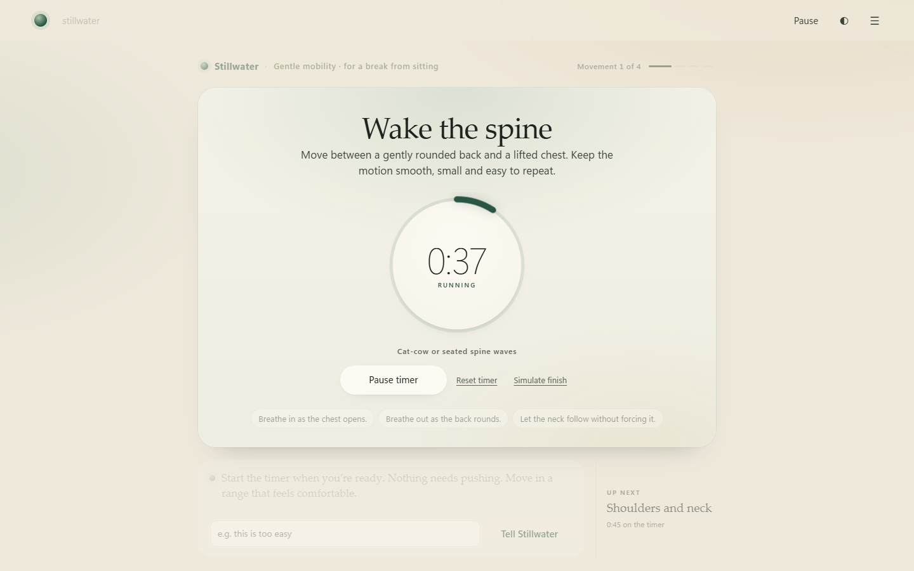

# Stillwater

A calm, text-only movement companion. You say what today needs in your own words. Stillwater understands it, keeps you safe, and gets you moving within two questions.



## The idea

Most fitness apps ask you to fit their plan. Stillwater starts from how you actually are today, typed the way you'd say it: "hunched over a laptop since 8", "my knee's being weird", "my wrists are tired". The AI's job is to **understand** that, including the cases where it has to stop and say "not today". It is not there to generate a workout.

## Design decisions

1. **Claude understands; trusted code draws.** Claude reads free text and returns a schema-checked interpretation through structured outputs. Every screen, duration and safety message is drawn by local code, so a model mistake can't invent a movement, a duration, or medical advice. See `src/server/guide.ts` and `skills/guide.md`.
2. **Safety has a floor.** A keyword layer always runs alongside Claude. Claude can *raise* a concern the keywords missed, but can never lower one the keywords found. If the API fails, the keywords answer and the reply says so.
3. **Two questions, then movement.** First an optional name, then "what does today need?". The fitness word moved from the front door to the ending, where it names something you just did ("You met this in *Hip hinge reach*"). With Remember me turned on, your words collect on the home screen.
4. **Honest about what it can't see.** Timers measure time on a page, not movement. The ending never claims you completed, improved or burned anything.

## Evidence

`npm run eval` scores both layers on 44 realistic, messy phrasings: body concerns, figures of speech, needs and mid-session requests. Results are in [eval/RESULTS.md](eval/RESULTS.md).

| | Pass | Missed body concern | False alarm |
|---|---|---|---|
| Keyword layer only | 14/44 | 10/16 | 0 |
| Claude (Opus 5.5 via Claude plan) + keyword floor | **44/44** | **0/16** | **0** |

Run on 2026-10-11 through the Claude plan route; median 6.9 s per message.

The keyword layer misses phrasings like "my knee feels weird", "that pinched" and "nearly blacked out". That gap is why the live layer exists.

What the first live run caught: 42/44. The keyword floor flagged "pain in the neck kind of day" (the floor now ignores pain idioms, and a test proves real pain next to them is still caught), and Claude read "easy peasy" as a comment rather than a request (skills/guide.md now says that counts as an offer to go harder). **Caveat:** the cases were written alongside the skill, so 44/44 shows the design works, not that it generalises. The next step is a held-out set written by someone else.

## Run it

Requires Node.js 22.18+.

```sh
npm ci --ignore-scripts
npm start            # http://127.0.0.1:5102, starts in Mock (no key, nothing leaves your machine)
```

To use Claude, set `ALLOW_CLAUDE_PLAN=true` in `.env` to use your Claude Pro/Max login through the official `claude` CLI, or `ALLOW_CLAUDE_API=true` with `ANTHROPIC_API_KEY`. Then restart, choose **Claude (guided)** in the menu, and consent. See [docs/RUNTIMES.md](docs/RUNTIMES.md).

**Try:** type *"been hunched over a laptop all day"*, accept the suggestion, and start the timer. Then type *"my wrists are tired"* (you'll get a small change to the current movement) and *"ooh that pinched"* (the session pauses for safety).

## Tested

- `npm run check`: typecheck, safety lint, and unit and HTTP tests, including the safety floor and fallback with a fake model. On Windows, 4 tests are skipped with a stated reason: 3 need the Claude CLI runner (macOS and Linux only) and 1 needs symlinks.
- `npm run test:ui`: Playwright browser journeys in Chrome.
- `npm run eval`: keyword layer always; Claude when enabled. Verified live on 2026-10-11 through the Claude plan route, plus end-to-end turns through the running server (a need, a mid-session tip, a safety hold).

## Limits

- The understanding layer is only as good as `skills/guide.md` and the eval set. 44 cases is a start, not proof.
- Claude adds a network round trip per typed message (about 6–7 s on the plan route; see eval/RESULTS.md). Taps and commands never call the model.
- Typed messages are sent to Anthropic in Claude mode. Mock sends nothing. The plan route counts toward your Claude plan's usage limits.
- No voice, sensing or account. Memory is opt-in and stays in this browser.

## More

- **Walkthrough video:** `Stillwater - Walkthrough.webm`, the full journey with Claude live. Re-record it with `npm run walkthrough` (needs Claude enabled), which also refreshes `docs/images/`.
- **Requirements and changes:** `Stillwater - BRD.docx` (v2.0) covers the gap analysis against the brief, requirements, change log, risks and acceptance results.
- **Product story:** `docs/Stillwater - Product Case Study.docx` (v2) explains each change as problem, options, decision and evidence.
- **Architecture:** [docs/HARNESS.md](docs/HARNESS.md).
